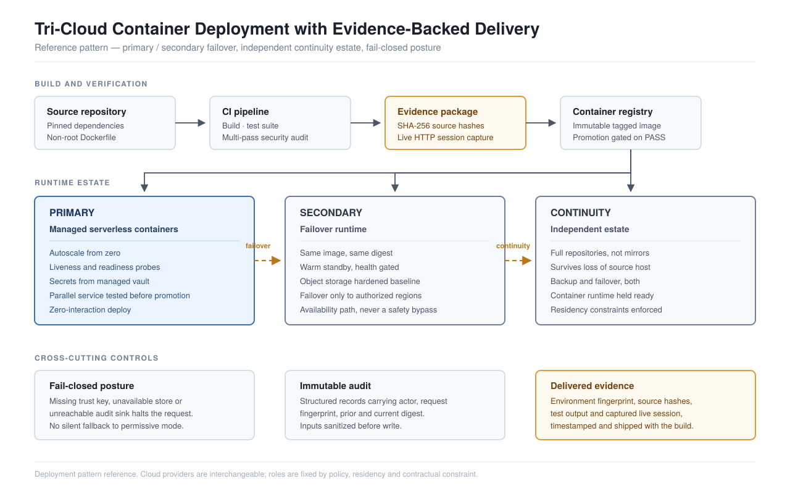

# Container Reference Service

A minimal FastAPI service published as a reference for how I containerize and verify deployments. The application itself is deliberately trivial — a unit-conversion endpoint. What it demonstrates is the delivery standard applied to it.

## What ships with every build

| Artifact | Purpose |
|---|---|
| `Dockerfile` | Non-root runtime, pinned base image, container healthcheck, gunicorn with uvicorn workers |
| `tests/` | Behavioural test suite covering success paths, boundary rejection, malformed payloads and unknown routes |
| `smoke_and_evidence.sh` | Runs the suite, boots the server, exercises live endpoints, writes a timestamped evidence folder |
| `EVIDENCE/` | Environment fingerprint, SHA-256 source hashes, test output, captured live HTTP session |
| `.github/workflows/ci.yml` | Runs the suite, regenerates evidence as a retained artifact, builds the image, asserts non-root runtime and verifies live endpoints including rejection behaviour |

The evidence folder is the point. A deployment is not complete because it was handed over — it is complete because there is a reproducible artifact showing the service ran and behaved as specified, with the exact source state that produced it recorded by hash.

## Running it

```
pip install -r requirements.txt
./smoke_and_evidence.sh
```

Output lands in `EVIDENCE/<UTC timestamp>/`.

## Container

```
docker build -t container-reference:1.0.0 .
docker run --rm -p 8080:8080 container-reference:1.0.0
```

## Endpoints

| Method | Path | Behaviour |
|---|---|---|
| GET | `/healthz` | Liveness, service identity and version |
| GET | `/readyz` | Readiness with uptime |
| POST | `/v1/convert` | Converts between Celsius and Fahrenheit; rejects unsupported units and out-of-bound values with 422 |

## Deployment pattern



Primary runtime with a health-gated failover target and an independent continuity estate holding full repositories rather than mirrors. Providers are interchangeable; the roles are fixed by policy, residency and contractual constraint. Failover is an availability path and never a way around a safety decision.

## Target platforms

Built to deploy unchanged to Google Cloud Run, AWS App Runner and Azure Container Apps. Listens on `$PORT` 8080, runs as UID 10001, no host dependencies, no persistent local state.
